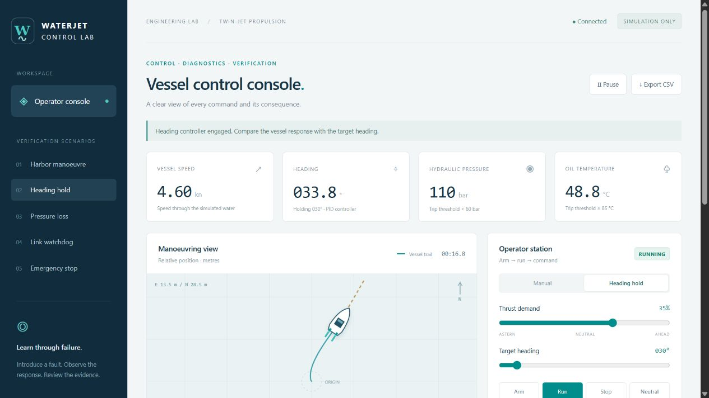
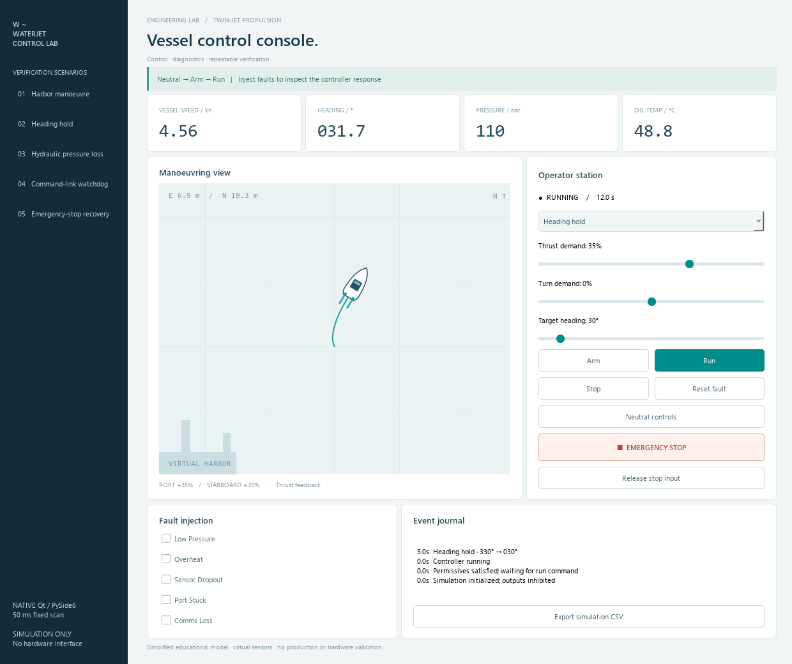
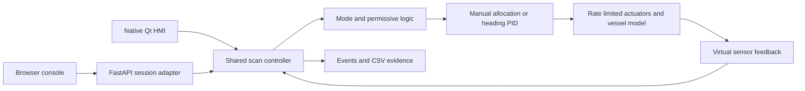

# Waterjet Control Lab

**A marine control simulator built to make failures visible, recovery deliberate, and verification repeatable.**

**[Open the live demo](https://waterjet-control-lab.onrender.com/)** · [Verification runs](https://github.com/AIArjun/waterjet-control-lab/actions)

No login, passcode or hardware is required. The free Render instance may take around a minute to wake after inactivity. Choose **Heading hold** to start a scenario, or use Neutral → Arm → Run to explore manually.

Operate a simulated twin-jet vessel from a native **Qt/PySide6 HMI** or a browser console. Apply thrust, hold a heading, interrupt commands, freeze an actuator, and inspect exactly why the controller inhibited its outputs.

This is an independent educational project. It is not a Marine Jet Power product, a calibrated vessel digital twin, or a certified safety controller. All sensors and actuators are simulated.



## What it demonstrates

- A deterministic **50 ms simulation scan** with separate command, controller, actuator and plant stages.
- Explicit **Disarmed → Armed → Running** transitions, startup permissives, latched faults and emergency-stop recovery without automatic restart.
- Twin-jet signed-thrust allocation, rate limits, actuator feedback and a simplified planar vessel model.
- Heading control with angle wraparound, derivative on measured yaw rate and integral anti-windup.
- Five fault injections: hydraulic pressure loss, overheating, stale commands, stale sensor data and a stuck port actuator.
- Timestamped events, 10 Hz telemetry and CSV evidence from reproducible scenarios.
- An isolated web session for each visitor; both interfaces use the same Python controller.

The useful engineering question is not just “does the boat move?” It is “what happens when an input is wrong, and what must an operator do before motion is enabled again?”

## Run on Windows

Python 3.11 or newer is required. No PLC, Docker, Node.js, account, API key or paid service is needed to run the application.

1. Double-click **Setup.cmd** once. It installs dependencies in `%USERPROFILE%\.venvs\waterjet-lab` to avoid Windows long-path failures in Qt packages.
2. Double-click **Start-Web.cmd**, then open **http://127.0.0.1:8787**.
3. Or double-click **Start-Qt.cmd** for the native desktop panel.

The launchers leave their terminal open so errors are visible. Close that terminal or press Ctrl+C to stop the server. The web service listens on the local computer only by default.

## Run on Linux or macOS

```bash
python3 -m venv .venv
source .venv/bin/activate
python -m pip install -r requirements-dev.txt
python -m pip install -e '.[desktop,dev]'
waterjet-lab
# In a second terminal using the same environment:
waterjet-qt
```

On a minimal Linux desktop, Qt may also need system display libraries. The CI workflow lists the libraries used on Ubuntu. A browser-only install can use `requirements-web.txt` and `pip install -e .` instead.

## A two-minute demonstration

1. Keep both demands neutral; select **Arm**, then **Run**. Increase thrust. Observe actual actuator feedback catching up with demand.
2. Choose **Heading hold** in the scenario rail. The vessel starts at 330° and aims for 30°, crossing north under a simulated eastward wind force.
3. Choose **Pressure loss**. The controller latches `LOW_PRESSURE` and inhibits both thrust commands.
4. Clear the pressure injection, select **Neutral**, then **Reset fault**. The state returns to **Disarmed**. It requires a fresh Arm and Run sequence.
5. Choose **Emergency stop**. Release the stop input: the latch remains. Reset and restart are separate actions.
6. Export CSV and correlate the transition with the recorded demands, outputs, feedback and alarm code.

For a stuck-actuator demonstration, run at steady thrust, inject **Port actuator stuck**, then change thrust demand. A sensor frozen exactly at its current setpoint is not observable until the demand changes. This limitation is intentional and tested.

## Verification

**First verified release:** 53 pytest cases passed locally on Windows and in GitHub Actions on both Windows and Ubuntu. All seven measured scenarios passed on both CI platforms. Current runs and downloadable evidence are available in [GitHub Actions](https://github.com/AIArjun/waterjet-control-lab/actions). A passing workflow does not validate real hardware or the draft Structured Text block.

```bash
python -m pytest -q
ruff check .
ruff format --check .
python -m waterjet_lab.verification --output artifacts/verification
python -m waterjet_lab.desktop --screenshot artifacts/native-qt.png
```

The verification command creates seven measured checks, CSV traces and SHA-256 hashes. Inspect [the generated report](artifacts/verification/verification.json) instead of relying on screenshots alone. The report records the platform and model parameters. Hashes check trace integrity; they do not establish independent validation or safety certification.

The deterministic heading scenario reaches approximately **1.05° absolute error at 60 simulated seconds**, against an acceptance threshold of 2°. Pressure and temperature trips inhibit outputs on the next scan. The command watchdog trips at 0.75 seconds since the last accepted command; the independent sensor watchdog trips at 0.25 seconds since the last sensor update. These are simulation results for the documented model and scenario, not vessel performance claims.



## Architecture



| Area | Read this |
| --- | --- |
| Requirements, transitions and tests | [Requirements and traceability](docs/requirements.md) |
| Units, equations and limitations | [Model and architecture](docs/model.md) |
| Interview demonstration and learning tasks | [Demo guide](docs/demo-guide.md) |
| Next step toward a real PLC runtime | [PLC learning guide](docs/plc-guide.md) |
| Local API | Open `/api/docs` while the server is running |
| Deployment | [Deployment notes](docs/deployment.md) |

## Current boundaries

**Implemented:** Python simulation, native Qt display, web display, heading control, fault injection, tests and trace exports.

**Reference only:** the Structured Text permissive block in `plc/`. It has not been compiled or executed in CODESYS/OpenPLC and is not connected to either HMI. Do not describe this release as PLC runtime integration.

There is no hardware-in-the-loop test, real marine CAN/fieldbus integration, vessel calibration, classification approval, real-time operating guarantee, station keeping, detailed engine/clutch model or hydraulic reversing-bucket geometry. The browser advances time by requesting simulation scans. Pausing or closing it pauses that simulation; the watchdog demonstration uses deliberate command loss while the plant continues stepping. The Qt timer is also not a real-time scheduler.

The model removes propulsive force immediately when the controller inhibits it, while the actuator indication decays. Real stuck hardware can retain thrust and requires independent shutdown mechanisms. This simplified response must not be used to reason about a real vessel's stopping distance or safety.

## References and attribution

The implementation is original project code. These primary sources informed its learning scope; their code, vehicle parameters and branding are not incorporated:

- [Marine Jet Power controls](https://marinejetpower.com/controls/) — the type of operator, diagnostic and propulsion interfaces this learning project explores. No affiliation is implied.
- [MIT 2.680 Autonomous Rescue Challenge](https://marine-robotics.mit.edu/2.680/pmwiki/pmwiki.php?n=Lab.ClassRescue1) — simulation-first marine robotics coursework.
- [Fossen's PythonVehicleSimulator](https://github.com/cybergalactic/PythonVehicleSimulator) — a reference for more rigorous marine modelling; our simplified plant is not an implementation of those vehicle models.
- [Qt for Python](https://doc.qt.io/qtforpython-6/) and [FastAPI](https://fastapi.tiangolo.com/) — interface and web adapter documentation.

Developed with AI coding assistance. Treat the learning tasks and individual explanations as part of the project, not as optional preparation for an interview.

MIT license for original project code. Qt and other dependencies retain their own licenses; review those before distributing packaged binaries.
