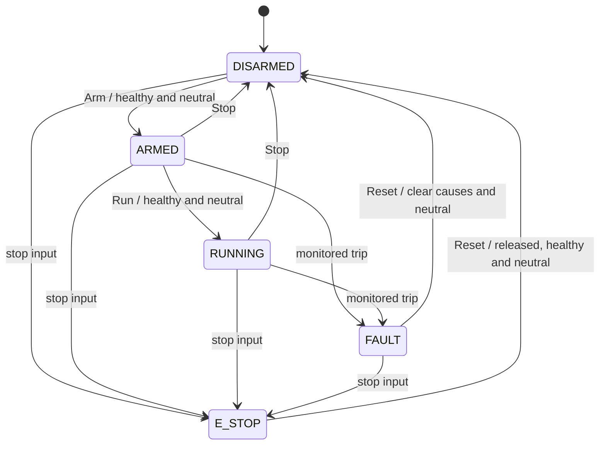

# Requirements and verification traceability

This is a software simulation specification, not a vessel safety requirements specification. All deadlines below use simulation time. `DT = 0.05 s`.

| ID | Requirement | Evidence |
| --- | --- | --- |
| CTRL-01 | Boot with all commanded outputs inhibited, even with non-neutral demand. | `test_cold_start_inhibits_every_output` |
| CTRL-02 | Arm and Run are separate actions; both require healthy inputs, released stop and neutral manual demands (absolute value ≤ 0.02). | `test_run_requires_arm_and_arm_requires_neutral`, `test_demand_changed_after_arming_requires_neutral_before_run` |
| CTRL-03 | Pressure < 60 bar or temperature ≥ 85 °C prevents arming and trips an armed/running controller on the next scan. | `test_bad_startup_permissives_inhibit_arm`, `test_sensor_trip_inhibits_outputs_in_next_scan_and_latches` |
| CTRL-04 | Emergency stop immediately inhibits commanded thrust, latches and cannot be cleared by releasing the input alone. | `test_emergency_stop_release_does_not_reset_or_restart` |
| CTRL-05 | Reset requires clear causes and neutral manual demands. Reset returns to Disarmed; it never automatically restarts. | `test_reset_rejects_active_fault_even_if_controls_are_neutral`, `test_reset_does_not_clear_a_stuck_actuator_fault` |
| CTRL-06 | A command age ≥ 0.75 s inhibits thrust and latches COMMAND_STALE. | `test_command_watchdog_exact_boundary_and_recovery` |
| CTRL-07 | Sensor age ≥ 0.25 s trips independently of command heartbeats. | `test_sensor_watchdog_independent_of_command_heartbeat` |
| CTRL-08 | Healthy thrust demand changes by at most 0.8 normalized units/s. A trip bypasses that slew limit to zero demand. | `test_demand_slew_limit`, CTRL-03/04 |
| CTRL-09 | A port feedback mismatch > 0.20 with unchanged feedback for ≥ 0.60 s trips. A freeze at setpoint requires excitation before it is observable. | `test_frozen_actuator_at_setpoint_requires_a_demand_change_to_be_observable`, `test_reset_does_not_clear_a_stuck_actuator_fault` |
| CTRL-10 | Angle error takes the shortest arc; the documented north-crossing scenario has < 2° absolute error at 60 s. | `test_heading_error_uses_shortest_arc`, `test_heading_hold_wraps_north_and_converges_in_documented_scenario` |
| SIM-01 | Symmetric positive/negative thrust produces ahead/astern movement with correct turn sign. | `test_symmetric_thrust_drives_north_without_yaw_in_calm_water`, `test_reverse_thrust_moves_astern`, `test_positive_turn_rotates_clockwise` |
| SIM-02 | Repeated scenario inputs give identical CSV evidence. Export includes the present trip state between 10 Hz samples. | `test_scenario_is_deterministic_and_csv_matches_actual_history`, `test_csv_includes_immediate_trip_between_telemetry_samples` |
| API-01 | Visitors have independent simulations; invalid commands are rejected without echoing raw request input. | `tests/test_api.py` |
| HMI-01 | The native Qt panel uses the real controller; controls remain readable and usable in an offscreen render. | `tests/test_desktop.py`, visual inspection of `artifacts/native-qt.png` |
| VER-01 | Scenario reports measure actual state, save traces and verify trace hashes. | `tests/test_verification.py` |

## Transition design

Priority: an active emergency-stop input dominates other states. A monitored trip dominates normal running. A normal Stop cannot clear a fault. Releasing the stop changes the input, not the latched state. Fault monitoring prevents arming when unhealthy; monitored faults latch when already Armed or Running.

The manual neutral check applies to `surge` and `turn`; in Heading mode the PID can command differential thrust after Run even with zero surge. A real system needs mode-specific motion permissives and independent risk assessment.

## Evidence interpretation

The seven checks in `verification.json` are scenarios, not the unit-test count. `detection_s` is measured from injection to the trip and is quantized to the scan. Command-loss detection can be 0.70 s from injection when the last command was received 0.05 s earlier; its age at the trip is still 0.75 s. The stuck-port check changes demand immediately after injection; it does not promise a fixed detection latency for every setpoint.

An inhibited command is not an instantaneous vessel stop. Inertia and simulated wind still move the plant. Feedback can remain nonzero while demands are zero. Export preserves that distinction.
